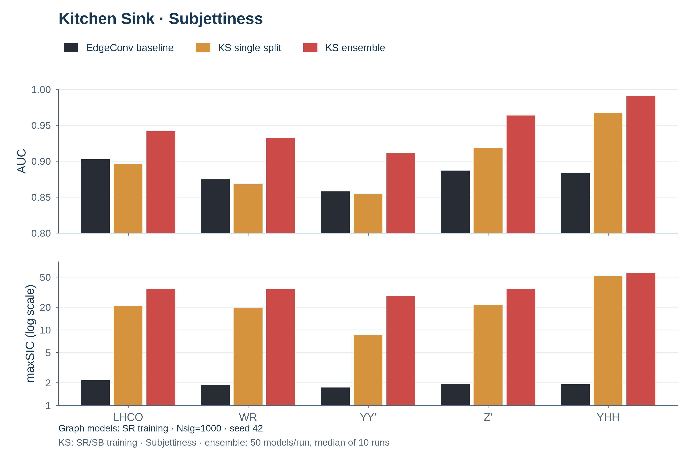
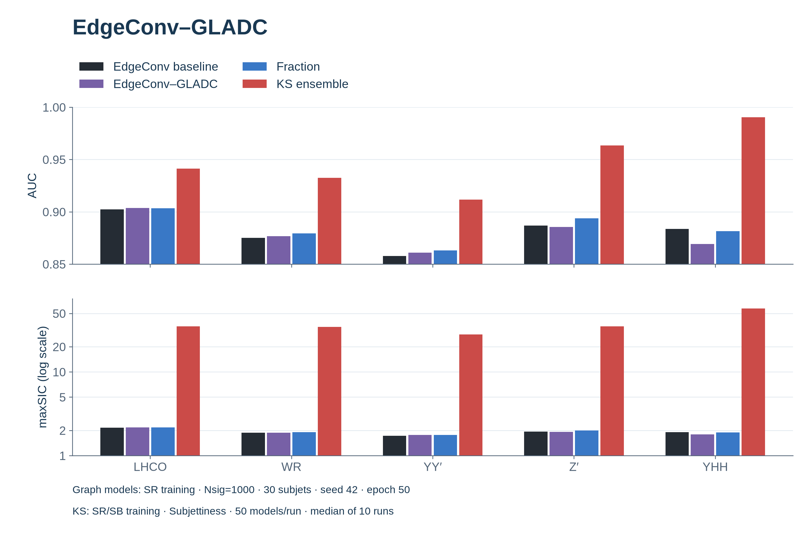
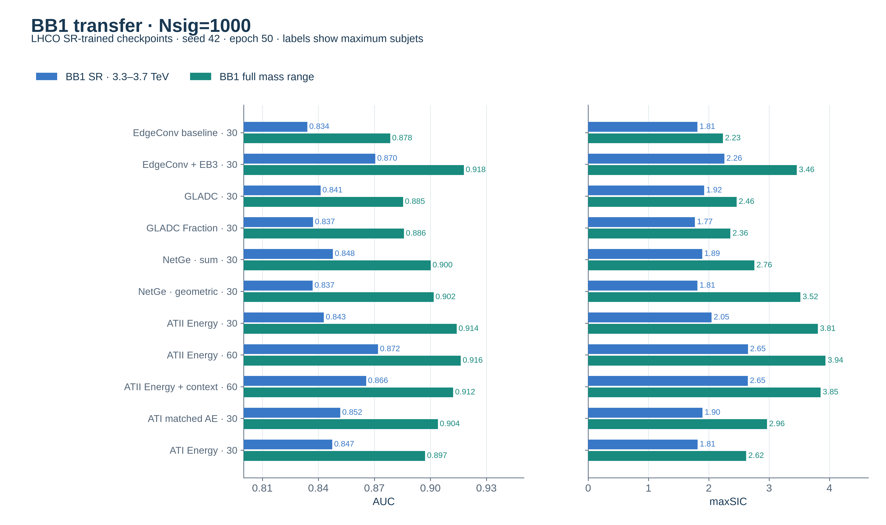
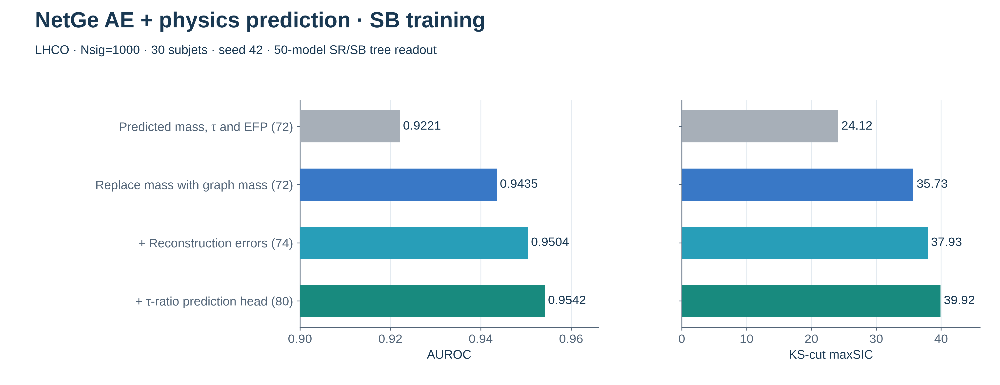
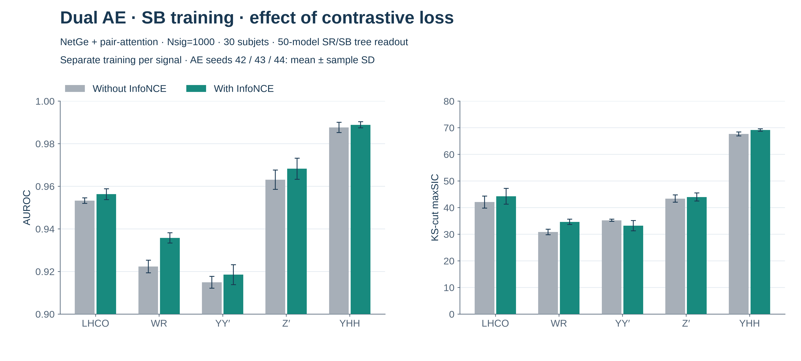

# Results

Main results since the project rebuild, with `Nsig=1000`.
Sections 2–5 and 7–8 use SR-trained graph models; section 6 compares SR and SB;
section 9 uses SB-trained AEs followed by SR/SB tree readout.

LHCO and each KS test contain 340,000 background and 20,000 signal events in
`3.3 < mJJ < 3.7 TeV`. `Nsig` counts injection before mass cuts and splitting.
See [data settings](data_pipeline.md#2-cwola-settings).

Table entries are **AUC / maxSIC**, using the paper’s background-statistics cut.
Graph-model results use the final epoch, not the best test epoch. These tests
were used throughout development. The main graph resolution is **30 subjets**;
60-subjet results are separate.

Graph models use seed 42 unless stated otherwise. Multi-seed results report
mean ± sample SD; the KS ensemble reports medians across 10 runs.

[KS](#1-kitchen-sink-reproduction-subjettiness) ·
[Baseline](#2-edgeconv-baseline-regularization-and-calibration) ·
[GLADC](#3-edgeconvgladc-and-variations) ·
[NetGe](#4-netge-jet-max-message--bilinear-decoder) ·
[ATII](#5-sdmatii-and-energy-adaptations) ·
[NAT](#6-sdmnat) ·
[ATI](#7-sdmati-noise-generated-jets) · [BB1](#8-bb1-transfer) ·
[AE + trees](#9-ae-features--tree-readout-sb)

## 1. Kitchen Sink reproduction: Subjettiness

```bash
FEATURES=subjettiness bash scripts/kitchensink.sh
FEATURES=subjettiness ENSEMBLE=1 RUNS=10 bash scripts/kitchensink.sh
```

GBDTs use 56 features to classify SR (`3.3–3.7 TeV`) versus SB (`3.1–3.3`
and `3.7–3.9 TeV`), with a 50/50 training/validation split.

- **Single split:** one classifier per signal, seed **42**.
- **Ensemble:** average predictions from **50 classifiers per run**; report
  median AUC and median maxSIC over **10 runs**, following the
  [paper's ensemble protocol](https://arxiv.org/html/2604.20965v1#S2.SS2).

| Our reproduction | LHCO | WR | YY′ | Z′ | YHH |
| --- | ---: | ---: | ---: | ---: | ---: |
| Single split | 0.8964 / 20.584 | 0.8687 / 19.389 | 0.8544 / 8.567 | 0.9186 / 21.321 | 0.9673 / 52.106 |
| Ensemble | 0.9414 / 34.963 | 0.9326 / 34.452 | 0.9116 / 28.018 | 0.9634 / 35.121 | 0.9903 / 57.066 |



## 2. EdgeConv: baseline, regularization and calibration

### Reported SR settings

```bash
SAMPLE=SR bash scripts/baseline.sh
SAMPLE=SR bash scripts/regularization.sh
SAMPLE=SR bash scripts/calibration.sh
```

The graph-model results in sections 2–5 use SR training. Current
[training commands](../README.md#3-train) use SB by default.

- Train on SR only: 60,000 training and 60,000 validation events per signal.
- 30-subjet Unique-6 graphs; node `ln(pT)` and three physical edge features.
- Seed **42**, 50 epochs, evaluation every 5 epochs; report **epoch 50**.
- AdamW, OneCycleLR peak `0.003`, batch 256 events (512 jets), weight decay
  `0.01`, gradient clipping `1.0`.
- Objective: node MSE + physical-edge MSE. Event score: `s0 + s1`, where each
  jet error is node MSE + edge MSE.

### Methods

- **Baseline:** [EdgeConv](../src/models/edgeconv.py).
- **+ EB3:** same model, adding a penalty on latent distances between connected
  nodes, with weight `1`.
- **Calibration:** convert baseline and EB3 event scores to validation
  percentiles, then blend them using jet momentum concentration and radius.
  Fit the calibration statistics on SR validation.

### Epoch-50 results

| Signal | Baseline | + EB3 | Calibration |
| --- | ---: | ---: | ---: |
| LHCO | 0.9024 / 2.148 | 0.9206 / 2.555 | 0.9242 / 2.677 |
| WR | 0.8752 / 1.873 | 0.8723 / 1.839 | 0.8843 / 1.987 |
| YY′ | 0.8578 / 1.728 | 0.8749 / 1.967 | 0.8775 / 1.985 |
| Z′ | 0.8869 / 1.940 | 0.8777 / 1.853 | 0.8998 / 2.047 |
| YHH | 0.8836 / 1.903 | 0.8316 / 1.630 | 0.8893 / 1.945 |


EB3 improves LHCO and YY′ but hurts the other three signals. Calibration
improves both metrics over baseline on all five signals.

## 3. EdgeConv–GLADC and variations

LHCO example; select other signals with `SPLIT_FILE`:

```bash
SAMPLE=SR MODEL=gladc RUN_DIR=runs/gladc_sr bash scripts/train.sh --gladc-variant original
```

[EdgeConv–GLADC](../src/models/gladc.py) adds node cycle, graph cycle and
contrastive losses to the EdgeConv baseline, all with weight `1`.

**Fraction** uses `ln(pT_i / sum(pT))` within each jet, then standardizes node
and edge features using training-set means and standard deviations.

| Model | LHCO | WR | YY′ | Z′ | YHH |
| --- | ---: | ---: | ---: | ---: | ---: |
| Baseline | 0.9024 / 2.148 | 0.8752 / 1.873 | 0.8578 / 1.728 | 0.8869 / 1.940 | 0.8836 / 1.903 |
| EdgeConv–GLADC | 0.9038 / 2.178 | 0.8767 / 1.875 | 0.8611 / 1.763 | 0.8855 / 1.918 | 0.8692 / 1.793 |
| Fraction | 0.9035 / 2.166 | 0.8795 / 1.909 | 0.8630 / 1.767 | 0.8939 / 1.990 | 0.8816 / 1.885 |



Fraction improves both metrics over EdgeConv–GLADC on four signals, with a small
LHCO decrease.

[What we tried and learned](edgeconv-gladc.md).

## 4. NetGe-Jet: max-message + bilinear decoder

```bash
SAMPLE=SR MODEL=netge RUN_DIR=runs/netge_sr bash scripts/train.sh --netge-variant max_bilinear
```

Use `--objective full` for NetGe–GLADC and a separate `RUN_DIR`.

- Standardize node and edge features using training-set means and standard deviations.
- Embed nodes with `Linear + GELU`; combine self, neighbor-difference and edge
  features, using max aggregation and a two-dimensional node latent.
- Use a symmetric linear + bilinear edge decoder.
- **Geometric score:** replace `s0 + s1` with `2 * sqrt(s0 * s1)`.
- **NetGe–GLADC:** add node cycle,
  graph cycle and contrastive losses, each with weight `1`.

The first two rows use the same checkpoints; the third is trained with the
auxiliary losses.

| Variant / event score | LHCO | WR | YY′ | Z′ | YHH |
| --- | ---: | ---: | ---: | ---: | ---: |
| Reconstruction / sum | 0.9131 / 2.465 | 0.8863 / 2.065 | 0.8685 / 1.903 | 0.9166 / 2.274 | 0.8927 / 1.966 |
| Reconstruction / geometric | 0.9239 / 2.966 | 0.8908 / 2.193 | 0.8793 / 2.175 | 0.9347 / 2.720 | 0.9170 / 2.265 |
| NetGe–GLADC / geometric | 0.9263 / 3.138 | 0.8867 / 2.109 | 0.8876 / 2.323 | 0.9151 / 2.259 | 0.8961 / 1.998 |


Geometric scoring improves both metrics on all five tests. Adding cycle and
contrastive losses helps LHCO and YY′, but lowers WR, Z′ and YHH. We retain
reconstruction-only training with geometric scoring as the main NetGe variant.

[NetGe variations and what we learned](netge.md) ·
[NetGe–GLADC: cycle and contrastive](netge-gladc.md).

## 5. SDM–ATII and energy adaptations

```bash
SAMPLE=SR SIGNAL=LHCO VARIANT=energy SUBJETS=30 bash scripts/atii.sh
```

Select `original`, `energy` or `context`, and 30 or 60 subjets, as labelled below.

Same SR splits, seed 42 and epoch-50 reporting. Train one model per signal.

- **Original ATII:** GIN generator and scalar critic; node features and adjacency.
  RMSprop `0.001`, batch 128 events. Score: negative critic output.
- **Energy:** NetGe max-message/bilinear generator and AE critic; fixed Unique-6
  connections, standardized node and physical-edge features. Adam `0.0002`
  with cosine decay to `0.000002`, batch 256 events.
- **Critic context:** add mean incident-edge features to the critic's node
  embedding, adding 96 parameters. The generator stays unchanged.

Energy versions use posterior-mean node/edge discrepancy + `0.01 × KL` +
critic energy of the reconstructed graph, summed over the two jets.

### 30 subjets

| Model | LHCO | WR | YY′ | Z′ | YHH |
| --- | ---: | ---: | ---: | ---: | ---: |
| Original ATII | 0.6783 / 1.057 | 0.6277 / 1.044 | 0.7150 / 1.141 | 0.9438 / 2.832 | 0.9835 / 6.901 |
| Energy | 0.9202 / 2.525 | 0.8668 / 1.841 | 0.8758 / 2.001 | 0.9437 / 2.730 | 0.9381 / 2.617 |

### 60 subjets

| Model | LHCO | WR | YY′ | Z′ | YHH |
| --- | ---: | ---: | ---: | ---: | ---: |
| Energy | 0.9388 / 3.732 | 0.9043 / 2.423 | 0.9050 / 2.634 | 0.9277 / 2.467 | 0.9301 / 2.455 |
| Energy + critic context | 0.9474 / 4.715 | 0.9133 / 2.841 | 0.9286 / 3.739 | 0.9147 / 2.310 | 0.9060 / 2.105 |


Energy 60 exceeds 0.90 AUC on all five signals. Critic context further improves
LHCO, WR and YY′, but lowers Z′ and YHH. At 30 subjets, Energy improves over
NetGe's geometric score on Z′ and YHH, but not on LHCO, WR or YY′.

[ATII experiments, BB1 results and commands](sdm.md#2-atii).

## 6. SDM–NAT

NAT jointly trains a generator to modify observed jets and a classifier to
separate original from generated jets. Unlike ATII, both minimize the same
objective; there are no alternating adversarial updates.

### Nsig=1000: SR versus SB training

```bash
SAMPLE=SR NSIG=1000 SIGNAL=LHCO VARIANT=energy bash scripts/nat.sh
SAMPLE=reference NSIG=1000 SIGNAL=LHCO VARIANT=energy bash scripts/nat.sh
```

Energy NAT, one model per signal, 30 subjets, seed 42, epoch 50. Classifier and
full-objective scores use the same weights. Full-objective scoring combines
classification losses, reconstruction discrepancy and KL at the posterior mean.

| Training / score | LHCO | WR | YY′ | Z′ | YHH |
| --- | ---: | ---: | ---: | ---: | ---: |
| SR / classifier | 0.9240 / 2.745 | 0.8827 / 1.953 | 0.8776 / 2.002 | 0.8680 / 1.782 | 0.8134 / 1.554 |
| SB / classifier | 0.9251 / 2.793 | 0.8827 / 1.954 | 0.8797 / 2.017 | 0.8714 / 1.805 | 0.8138 / 1.559 |
| SR / full objective | 0.9274 / 2.849 | 0.8954 / 2.106 | 0.8845 / 2.057 | 0.8737 / 1.816 | 0.8125 / 1.523 |
| SB / full objective | 0.9281 / 2.843 | 0.8961 / 2.116 | 0.8850 / 2.043 | 0.8780 / 1.850 | 0.8167 / 1.541 |


Changing SR to SB has little effect. Full-objective scoring helps four signals;
YHH remains weak. [BB1 transfer results](sdm.md#38-nsig1000-sr-versus-sb-training).

[NAT experiments: original GIN, physical generators, scores and AE controls](sdm.md#3-nat).

## 7. SDM–ATI: noise-generated jets

ATI generates jets from noise and trains a critic against them. The Energy
adaptation uses a reconstruction-based critic; inference scores the observed
jets with that critic.

### Nsig=1000, separate training per signal

```bash
SAMPLE=SR NSIG=1000 SIGNAL=LHCO VARIANT=energy bash scripts/ati.sh
```

Train the sparse AE/ATI pair separately on each signal's SR mixture: 30 subjets,
seed 42, epoch 50, Adam `0.001` with cosine decay and batches of 128 events.
The matched AE uses the same reconstruction backbone without the generator.

| Model | LHCO | WR | YY′ | Z′ | YHH |
| --- | ---: | ---: | ---: | ---: | ---: |
| Matched AE / sum | 0.9140 / 2.493 | 0.8737 / 1.888 | 0.8701 / 1.931 | 0.8915 / 1.954 | 0.8527 / 1.692 |
| Energy ATI / sum | 0.9107 / 2.420 | 0.8715 / 1.891 | 0.8724 / 1.976 | 0.8803 / 1.859 | 0.8364 / 1.604 |


ATI improves AUC only on YY′ in this comparison.

[ATI experiments: priors, fragmentation, message passing and negative results](sdm.md#1-ati).

## 8. BB1 transfer

```bash
python -m scripts.inference --checkpoint "$CHECKPOINT" \
  --split-file data/splits/BB1_SR.npz --output "$OUTPUT"
```

Use the LHCO-trained checkpoint for each method. Full range contains 999,166
background + 834 signal events; SR contains 120,279 background + 223 signal
events in `3.3 < mJJ < 3.7 TeV`.

### Nsig=1000

| Model | Subjets | BB1 SR | BB1 full range |
| --- | ---: | ---: | ---: |
| EdgeConv baseline | 30 | 0.8341 / 1.811 | 0.8785 / 2.234 |
| EdgeConv + EB3 | 30 | 0.8705 / 2.257 | 0.9179 / 3.458 |
| EdgeConv–GLADC | 30 | 0.8412 / 1.924 | 0.8854 / 2.461 |
| EdgeConv–GLADC Fraction | 30 | 0.8371 / 1.770 | 0.8859 / 2.358 |
| NetGe / sum | 30 | 0.8478 / 1.891 | 0.9001 / 2.756 |
| NetGe / geometric | 30 | 0.8369 / 1.812 | 0.9017 / 3.519 |
| ATII Energy | 30 | 0.8430 / 2.045 | 0.9141 / 3.808 |
| ATII Energy | 60 | 0.8720 / 2.649 | 0.9163 / 3.935 |
| ATII Energy + critic context | 60 | 0.8656 / 2.646 | 0.9122 / 3.854 |
| ATI matched AE | 30 | 0.8518 / 1.896 | 0.9040 / 2.965 |
| ATI Energy | 30 | 0.8474 / 1.815 | 0.8972 / 2.620 |



NetGe's geometric score improves full-range performance but lowers BB1 SR AUC
and maxSIC relative to the sum score.

## 9. AE features + tree readout (SB)

`Nsig=1000`, 30 subjets. Train and validate the AEs on SB, freeze them, then
train a 50-model SR/SB tree ensemble. Evaluate its mean probability in SR.
These are SB-trained experiments; sections 2–5 retain their SR-trained results.
[Methods, features and readout protocol](ae_readout.md).

### NetGe AE with physics prediction: LHCO, seed 42

```bash
for variant in predicted graph_mass errors ratios; do
    VARIANT="$variant" bash scripts/physics_ae.sh LHCO
done
```

| Variant | Tree inputs | AUROC | KS-cut maxSIC |
| --- | ---: | ---: | ---: |
| Predicted mass, τ and EFP | 72 | 0.9221 | 24.12 |
| Replace predicted mass with graph mass | 72 | 0.9435 | 35.73 |
| Add AE reconstruction errors | 74 | 0.9504 | 37.93 |
| Add τ-ratio prediction head | 80 | 0.9542 | 39.92 |

The first three use the same 50-epoch AE; the last trains a separate AE with
the ratio head.



### Dual AE: separate training per signal

```bash
for seed in 42 43 44; do
    SEED="$seed" bash scripts/dual_ae.sh LHCO XtoWRto3W XtoYYprime ZpToTpTp YtoHHto4T
done
```

NetGe + pair-attention with InfoNCE. Mean ± sample SD across AE seeds
42, 43 and 44; fixed event split and tree seeds. Each AE trains for 50 epochs
before another 50 epochs of joint training. Δ is the paired difference from
the same dual-AE control without InfoNCE.

| Signal | AUROC | KS-cut maxSIC | Δ AUROC | Δ KS-cut maxSIC |
| --- | ---: | ---: | ---: | ---: |
| LHCO | 0.9563 ± 0.0026 | 44.22 ± 2.97 | +0.0030 ± 0.0018 | +2.16 ± 0.94 |
| WR | 0.9358 ± 0.0024 | 34.64 ± 1.02 | +0.0134 ± 0.0007 | +3.79 ± 0.92 |
| YY′ | 0.9185 ± 0.0047 | 33.20 ± 1.94 | +0.0035 ± 0.0020 | -2.02 ± 1.58 |
| Z′ | 0.9682 ± 0.0049 | 43.98 ± 1.54 | +0.0051 ± 0.0004 | +0.60 ± 0.51 |
| YHH | 0.9889 ± 0.0015 | 69.14 ± 0.43 | +0.0012 ± 0.0017 | +1.48 ± 1.16 |

InfoNCE raises mean AUROC on all five signals; maxSIC improves on four and
falls on YY′.


