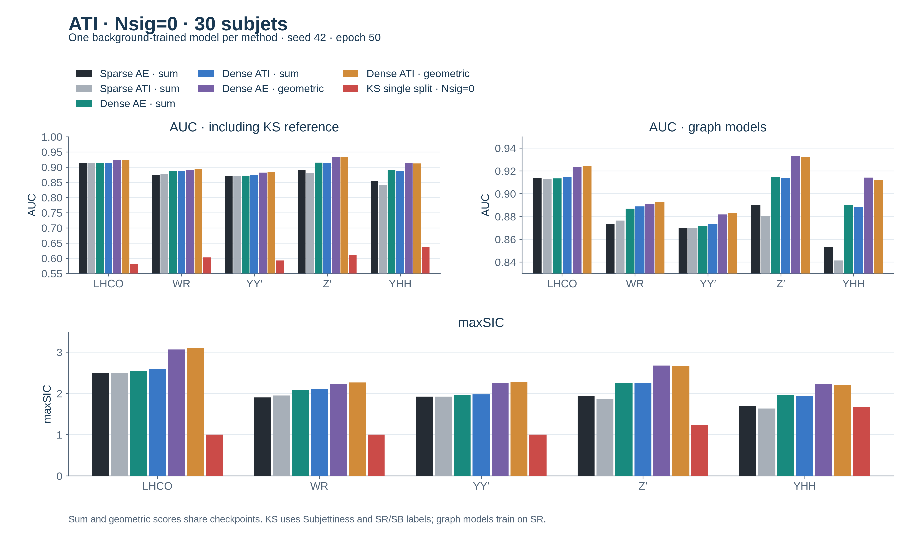
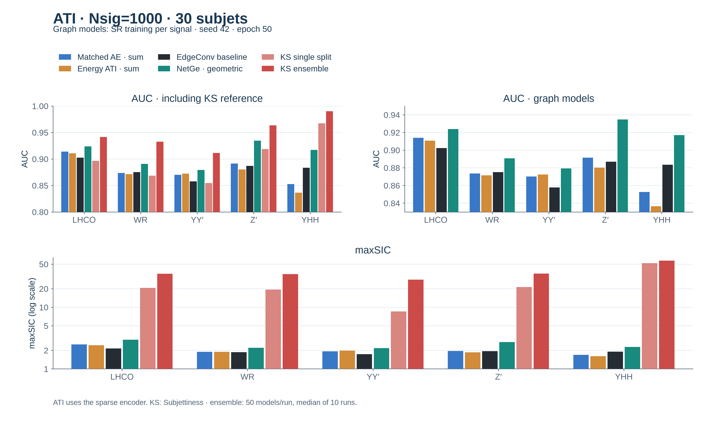
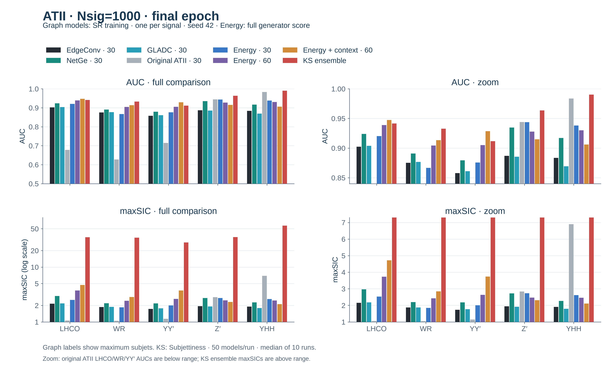
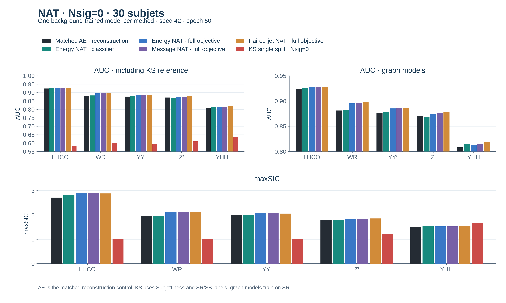
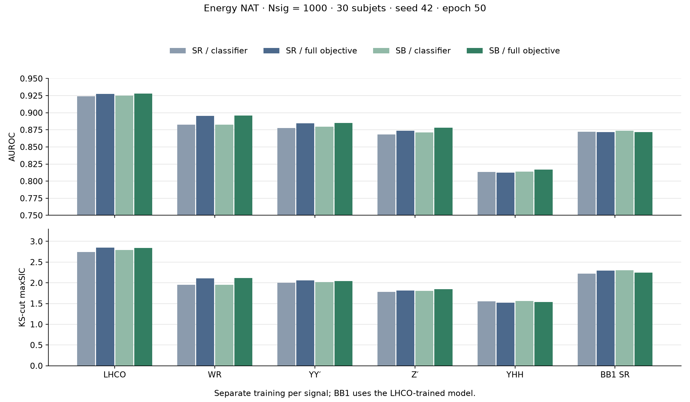
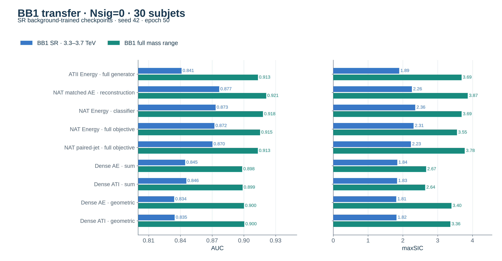

# SDM: ATI, ATII and NAT

Methods and jet-graph adaptations of
[Self-Discriminative Modeling for Anomalous Graph Detection](https://proceedings.mlr.press/v267/cai25k.html).

[ATI](#1-ati) · [ATII](#2-atii) · [NAT](#3-nat) ·
[BB1 transfer](#4-bb1-transfer-background-only)

## 1. ATI

ATI generates jets from noise, rather than reconstructing an observed jet.
The generator and critic train alternately. Our useful adaptation replaces a
scalar critic with an autoencoder: reconstruction error becomes the energy.

### 1.1 Run

```bash
VARIANT=energy bash scripts/ati.sh
VARIANT=dense bash scripts/ati.sh
```

Default: LHCO, `Nsig=1000`, **SB training**, 30 subjets, seed 42, 50 epochs.
Each command trains and evaluates. Set `SIGNAL`, `NSIG`, `DEVICE` and `SAMPLE`.

| `VARIANT` | Model |
| --- | --- |
| `original` | Noise MLP and GIN scalar critic; Wasserstein objective, score `−D`. |
| `energy` | Physical noise generator and NetGe AE critic; fixed energy margin. |
| `dense` | All-pair encoder; training pT prior, shape MMD and adaptive margin. |
| `control` / `dense_control` | Corresponding AE without the generator. |

Energy variants sum the two jet reconstruction errors. Use `--score geometric`
with `scripts.inference` for `2 × sqrt(E0 × E1)`.
Implementation: [`sdm_ati.py`](../src/models/sdm_ati.py).

### 1.2 Experiment settings

The results below use **SR training**. Unless stated otherwise: `Nsig=0`, seed 42,
30 subjets, one model trained on 60,000 LHCO SR
background events and evaluated on all signals. Report epoch 50, with evaluation
every 5 epochs. Tables show **AUC** unless labelled otherwise; maxSIC uses the
KS background-statistics cut. BB1 SR is a sixth target, not the full-range BB1 test.

Run that training setting with `SAMPLE=SR NSIG=0 VARIANT=dense bash scripts/ati.sh`.

### 1.3 From scalar critics to reconstruction energy

| Model | LHCO | WR | YY′ | Z′ | YHH | BB1 SR |
| --- | ---: | ---: | ---: | ---: | ---: | ---: |
| Paper-formula scalar critic | 0.2429 | 0.2732 | 0.2075 | 0.0607 | 0.0172 | 0.3837 |
| Physical-feature scalar critic | 0.6640 | 0.7302 | 0.6763 | 0.7079 | 0.7748 | 0.5786 |
| Frozen-generator replay | 0.6933 | 0.7343 | 0.6909 | 0.7697 | 0.8276 | 0.6225 |
| Matched AE | 0.9137 | 0.8734 | 0.8696 | 0.8904 | 0.8535 | 0.8515 |
| Energy ATI | 0.9131 | 0.8764 | 0.8696 | 0.8805 | 0.8414 | 0.8488 |

Scalar models use the fixed score `−D`; low AUCs are not reversed. Feature
standardization, separate topology heads and relaxed weight clipping did not
solve their ranking problem.

Energy ATI uses a max-message/bilinear AE critic and a physical generator.
The generator predicts momenta and positions, from which physical edges are
calculated. Adam `0.001`, cosine decay, 128 events per batch:

```text
Generator: E(generated)
Critic:    E(real) + 0.1 × max(0, margin − E(generated))
Score:     E(jet0) + E(jet1)
```

The initial margin is `0.2`. Energy scoring is much stronger than the scalar
critics, but adding adversarial training to the matched AE gives no broad gain.

### 1.4 Improve generated momentum and shape distributions

Successive changes: update the margin from training real/fake energies; sample
total scalar pT from the training background conditional on node count; add an
MMD penalty matching total pT, width and momentum concentration.

| Energy ATI recipe | LHCO | WR | YY′ | Z′ | YHH | BB1 SR |
| --- | ---: | ---: | ---: | ---: | ---: | ---: |
| Training-driven margin | 0.9152 | 0.8765 | 0.8715 | 0.8911 | 0.8547 | 0.8523 |
| + total-pT prior | 0.9142 | 0.8763 | 0.8699 | 0.8917 | 0.8555 | 0.8534 |
| + shape MMD | 0.9140 | 0.8756 | 0.8697 | 0.8924 | 0.8569 | 0.8518 |

MMD improves the measured generated-shape distribution, but not detection
overall. Wider generator interactions, a conditional-width model and diversity
penalties also failed to turn better generation into a broad AUC gain.

### 1.5 Give the encoder more pair information

The **dense encoder** sees all valid node pairs. Reconstruction and scoring
still use the original Unique-6 edges. No extra critic parameters are added.
Use the preceding prior/MMD/margin recipe for the ATI arm.

Entries are **AUC / maxSIC**.

| Model / event score | LHCO | WR | YY′ | Z′ | YHH |
| --- | ---: | ---: | ---: | ---: | ---: |
| Sparse AE / sum | 0.9137 / 2.499 | 0.8734 / 1.903 | 0.8696 / 1.920 | 0.8904 / 1.945 | 0.8535 / 1.698 |
| Sparse ATI / sum | 0.9131 / 2.492 | 0.8764 / 1.948 | 0.8696 / 1.923 | 0.8805 / 1.862 | 0.8414 / 1.633 |
| Dense AE / sum | 0.9134 / 2.548 | 0.8869 / 2.088 | 0.8719 / 1.953 | 0.9149 / 2.258 | 0.8904 / 1.952 |
| Dense ATI / sum | 0.9145 / 2.584 | 0.8888 / 2.113 | 0.8735 / 1.974 | 0.9140 / 2.247 | 0.8885 / 1.934 |
| Dense AE / geometric | 0.9236 / 3.063 | 0.8912 / 2.233 | 0.8819 / 2.256 | 0.9330 / 2.673 | 0.9143 / 2.228 |
| Dense ATI / geometric | 0.9245 / 3.107 | 0.8930 / 2.262 | 0.8834 / 2.275 | 0.9319 / 2.665 | 0.9121 / 2.203 |



This is the most useful structural direction from the ATI study: WR, Z′ and
YHH improve substantially over the sparse AE, although BB1 SR falls. Most of
the gain is already present without ATI. The ATI–AE contrast includes the
full generator recipe, not just one adversarial term.

The geometric rows rescore the same checkpoints with `2 × sqrt(E0 × E1)`:
gains on the five LHCO/KS tests, loss on [BB1 SR](#4-bb1-transfer-background-only).

### 1.6 Add information inside each subjet

Two features were examined: normalized subjet mass, and momentum sharing among
its particles, `−ln(sum_a q_a²)` with `q_a=pT_a/sum_b pT_b` inside the subjet.

| ATI variant | LHCO | WR | YY′ | Z′ | YHH | BB1 SR |
| --- | ---: | ---: | ---: | ---: | ---: | ---: |
| Mass as input only | 0.9151 | 0.8761 | 0.8711 | 0.8911 | 0.8541 | 0.8529 |
| Mass as input and target | 0.8491 | 0.7993 | 0.7966 | 0.9167 | 0.8963 | 0.7953 |
| Momentum sharing as input only | 0.9159 | 0.8778 | 0.8724 | 0.8927 | 0.8569 | 0.8512 |
| Momentum sharing as input and target, 2D latent | 0.8168 | 0.7760 | 0.7732 | 0.9524 | 0.9483 | 0.7592 |
| Same targets, 3D latent | 0.9057 | 0.8835 | 0.8635 | 0.9345 | 0.9229 | 0.8331 |

Input-only changes are small. Adding the new reconstruction target strongly
favors Z′/YHH at the expense of other signals. A third latent coordinate
recovers much of the lost reconstruction, but still does not improve all tests.
Its matched AE is within 0.001 AUC on every test: this is not an ATI-specific gain.

### 1.7 Other completed structural directions

| Direction | Result |
| --- | --- |
| Whiten physical edges | AE gains on WR/Z′/YHH, losses on LHCO/YY′/BB1 SR; ATI adds no broad gain. |
| C/A splitting-tree reconstruction and ancestor prediction | Tree ATI reaches 0.7298 LHCO; ancestor-context ATI 0.8161. Both trail the graph-reconstruction models. |
| Teacher–student feature prediction | LHCO 0.6459, Z′ 0.2411, YHH 0.2348 for ATI; not retained. |
| Conditional branch density and exposure weighting | Density ATI reaches 0.7889 LHCO; exposure weighting raises WR to 0.8928 but leaves BB1 SR at 0.7248. |
| Regional summaries and direction-aware context | Some Z′/YHH gains, no uniform improvement over Dense AE/ATI. |
| Mean/max fusion and momentum-weighted messages | Extra message capacity does not improve the retained dense-max model overall. |
| Reconstruct all node pairs | Z′/YHH improve, but LHCO/WR/YY′/BB1 SR fall versus the dense encoder with Unique-6 targets. |
| Add self-quadratic decoder terms | Background reconstruction improves; WR/Z′/YHH AUC falls. |
| Graph-to-set / low-rank cloud decoder | Reconstructed clouds use the latent code, but LHCO remains around 0.74. |
| Edge-only adversarial training | Similar to Dense ATI, with five of six target AUCs slightly lower. |
| Bounded, quantized or contractive latent codes | Bounding is close to the control; quantization and the tested contraction penalty reduce detection overall. |

#### Final prototype-memory experiment

Retrieve from 64 two-dimensional prototypes before decoding. Compare a fixed
bank with a trainable bank; keep the initial distance-derived temperature fixed.

| Model | LHCO | WR | YY′ | Z′ | YHH | BB1 SR |
| --- | ---: | ---: | ---: | ---: | ---: | ---: |
| Fixed-bank AE | 0.9078 | 0.8876 | 0.8755 | 0.6643 | 0.4753 | 0.8518 |
| Fixed-bank ATI | 0.9104 | 0.8915 | 0.8786 | 0.6635 | 0.4724 | 0.8542 |
| Learned-bank AE | 0.9065 | 0.8735 | 0.8613 | 0.8770 | 0.8405 | 0.8344 |
| Learned-bank ATI | 0.9082 | 0.8770 | 0.8635 | 0.8696 | 0.8268 | 0.8270 |

The fixed bank improves some tails and BB1 results but loses Z′/YHH sensitivity.
The learned bank trails the corresponding Dense model on every AUC. Two ATI
runs resumed from epoch 44 after interruption; all final-epoch export checks passed.

### 1.8 Different training settings

#### Nsig=1000, one model per signal

The sparse AE/ATI pair was repeated on each signal's SR mixture. AUCs are in
the [main comparison](results.md#nsig1000-separate-training-per-signal): ATI helps
only YY′. This is separate from the background-only dense study.



#### SR/SB weak supervision

One LHCO `Nsig=1000` SR/SB classifier was trained and transferred to every test.
It uses region labels, unlike the reconstruction-only SR training above.

| Method | LHCO | WR | YY′ | Z′ | YHH | BB1 SR |
| --- | ---: | ---: | ---: | ---: | ---: | ---: |
| CWoLa graph classifier | 0.8167 | 0.7424 | 0.7580 | 0.5258 | 0.4910 | 0.7522 |
| + generator regularization | 0.7354 | 0.6968 | 0.7305 | 0.5383 | 0.6133 | 0.6008 |

Generator regularization helps Z′/YHH but hurts the other four targets. Replacing
absolute momentum with per-jet fractions does not rescue this comparison.

#### 60-subjet resolution control, Nsig=0

| Method | LHCO | WR | YY′ | Z′ | YHH | BB1 SR |
| --- | ---: | ---: | ---: | ---: | ---: | ---: |
| Matched AE | 0.9118 | 0.8907 | 0.8670 | 0.9272 | 0.9027 | 0.8521 |
| Energy ATI | 0.9103 | 0.8908 | 0.8660 | 0.9212 | 0.8942 | 0.8446 |

Resolution helps some signals, but the same-resolution adversarial comparison
still provides no overall improvement.

### 1.9 What we learned

- Physical reconstruction and richer encoder messages matter more than the
  tested adversarial additions.
- Better generated distributions or smaller background loss do not reliably
  produce better anomaly ranking.
- Z′/YHH often favor different reconstruction information from LHCO/WR/YY′.
- Geometric scoring helps the five main signals but hurts BB1 SR.
- No completed ATI variant reaches 0.90 AUC on all six SR tests. Research is
  paused after the prototype-memory runs; no new experiment is queued.

## 2. ATII

ATII reconstructs input graphs and alternates generator and critic updates.
We adapted its generator, critic and anomaly score to jet graphs.

### 2.1 Experiment settings

- **Initial exploration:** `Nsig=0`, with 60,000 background training events and 60,000
  background validation events in the SR (`3.3 < mJJ < 3.7 TeV`). The paper
  assumes normal-only training; here, normal graphs are background jets.
- **Evaluation:** one background-trained model tested on LHCO, BB1 and all four
  KS signals. LHCO and each KS test contain 340,000 background and 20,000 signal
  events in the SR.
- **Protocol:** seed 42, 50 epochs, evaluation every 5 epochs; report epoch 50.
- **Metrics:** AUC / maxSIC, using the same KS background-statistics cut as the
  [results overview](results.md).

Sections 2.2–2.6 describe background-only training. Section 2.8 repeats the retained
versions with `Nsig=1000`, training separately for each signal.

These benchmarks guided the exploration; the results below are development
comparisons, not an untouched final holdout.

### 2.2 Start with paper-based ATII

- **Input:** 30-subjet graphs, node `ln(pT)` and binary Unique-6 adjacency.
- **Generator:** GIN Gaussian encoders sample node latents, then reconstruct
  node features and a continuous adjacency matrix.
- **Critic:** a separate GIN with Global Sum Pooling scores real and generated
  graphs. Alternate generator and critic updates.
- **Training:** RMSprop at `0.001`, batch 128 events; discrepancy and KL weights
  both `1`, with critic parameters clipped to `[-0.01, 0.01]`.
- **Event score:** `-D(jet0) - D(jet1)`; higher means more anomalous.

Implementation choices: three 16-channel GIN layers, concatenated to 48 channels;
10-dimensional node-wise Gaussian latents; node decoder `10 → 16 → 1` and
critic head `48 → 16 → 1`. Node squared error, adjacency BCE and both Gaussian
KL terms are summed within each jet, then averaged over jets. Padding and
diagonal pairs are excluded. These architecture and reduction choices are ours.

The result is strongly signal-dependent: LHCO AUC is **0.6734**, while Z′ and
YHH reach **0.9431** and **0.9833**. The critic stops changing in later epochs;
a diagnostic update is completely removed by weight clipping. Generator
gradients are also dominated by KL rather than the adversarial term.

Changing to a stabilized GIN, NetGe or EdgeConv scalar critic does not solve
this: LHCO AUC is **0.5226, 0.3947 and 0.3562**, respectively.

### 2.3 Replace the scalar critic with reconstruction error

The **Energy** adaptation keeps alternating generator/critic training, but
uses an autoencoder's reconstruction error as the critic. This follows the
[EBGAN energy idea](https://arxiv.org/abs/1609.03126), rather than the original
ATII critic.

- Use **NetGe max-message + symmetric linear/bilinear edge decoder**, with a
  two-dimensional node latent. Generator and critic have separate parameters.
- Standardize node `ln(pT)` and physical-edge `ln(theta)`, `ln(kT)`, `ln(z)`
  using training-set means and standard deviations.
- Keep Unique-6 connections fixed; generate node and edge features, not adjacency.
- Define energy `E(G)` as node MSE + physical-edge MSE. Average errors within
  each jet, then average over jets for training.
- Use Gaussian node latents in the generator, with log standard deviation
  bounded to `[-3, 1]`; reduce the KL weight to `0.01`.

The retained training recipe is:

```text
Generator: E(generated) + node/edge discrepancy + 0.01 × KL
Critic:    E(real) + 0.1 × max(0, 0.2 − E(generated))
```

Use Adam at `0.0002`, betas `(0, 0.9)`, cosine decay to `0.000002`, batch
256 events and gradient clipping at `1`. This replaces critic weight clipping.

With critic-energy scoring, LHCO reaches **0.9227 / 2.655**, versus
**0.9210 / 2.578** for the matched AE-only control. However, all four KS signals
are slightly worse than AE-only: adversarial training alone is not a consistent gain.

### 2.4 Change what we score

On the same 30-subjet Energy checkpoint, we compared three jet scores:

1. **Critic energy:** reconstruction error of the input graph, `E(G)`.
2. **Generator score:** node/edge discrepancy + `0.01 × KL`.
3. **Full generator score:** generator score + `E(reconstructed graph)`.

Generator scores use the posterior mean, without random sampling. Sum the
two jet scores to obtain the event score.

The generator score gives LHCO **0.9271 / 2.781** and BB1 SR **0.8740 / 2.640**.
Adding the reconstructed graph's energy changes the ranking: Z′ AUC rises
**0.8925 → 0.9417** and YHH **0.8594 → 0.9458**, but LHCO falls to **0.9140**
and BB1 SR to **0.8411**. All three scores use the same trained weights.

### 2.5 Increase resolution and add local edge information

- **Energy 60:** raise the maximum from 30 to 60 subjets. Keep the architecture,
  training recipe and full generator score fixed; refit feature scaling on
  the 60-subjet training graphs.
- **Energy 60 + critic context:** average the physical-edge features incident
  on each node, project them to 32 channels and add them to the critic's node
  embedding before GELU. This adds **96 parameters**. Max-message aggregation,
  generator architecture, losses and score stay unchanged.

The added local information improves all five LHCO/KS AUCs and maxSICs over
Energy 60, but lowers BB1 SR AUC.

### 2.6 Final results: background-only training

All Energy rows below use the **full generator score**.

| Model | LHCO | WR | YY′ | Z′ | YHH |
| --- | ---: | ---: | ---: | ---: | ---: |
| Original ATII, 30 | 0.6734 / 1.053 | 0.6094 / 1.035 | 0.7125 / 1.134 | 0.9431 / 2.806 | 0.9833 / 6.872 |
| Energy 30 | 0.9140 / 2.395 | 0.8583 / 1.760 | 0.8750 / 1.994 | 0.9417 / 2.690 | 0.9458 / 2.809 |
| Energy 60 | 0.9397 / 3.772 | 0.9073 / 2.500 | 0.9053 / 2.672 | 0.9246 / 2.405 | 0.9112 / 2.177 |
| Energy 60 + critic context | 0.9473 / 4.927 | 0.9178 / 3.444 | 0.9238 / 3.689 | 0.9385 / 2.723 | 0.9419 / 2.731 |

BB1 full range contains 999,166 background and 834 signal events. Its SR
contains 120,279 background and 223 signal events; apply the SR cut to the
same event scores.

| Model | BB1 full range | BB1 SR |
| --- | ---: | ---: |
| Original ATII, 30 | 0.7376 / 1.251 | 0.6284 / 1.064 |
| Energy 30 | 0.9133 / 3.688 | 0.8411 / 1.895 |
| Energy 60 | 0.9164 / 3.894 | 0.8740 / 2.742 |
| Energy 60 + critic context | 0.9120 / 3.974 | 0.8605 / 2.729 |

### 2.7 What we learned

- The original ATII critic performs poorly on several signals but remains
  especially strong on Z′ and YHH.
- Reconstruction-based critics are much more useful here than the tested
  scalar critics. Their improvement cannot be attributed to adversarial training alone.
- Generator scoring and higher subjet resolution give substantial gains,
  but neither improves every signal.
- With background-only training, local edge information helps all five LHCO/KS
  signals but lowers BB1 SR AUC. The mixed-training repeat below is less uniform.

### 2.8 Repeat with Nsig=1000

All **20 models** completed 50 epochs: four versions × five training signals.

- Train separately for LHCO, WR, YY′, Z′ and YHH, seed 42.
- Use each signal's SR mixture, retaining its injected signals. Truth labels
  do not enter the loss or feature-scaling fit.
- Keep each version's architecture, optimizer, loss and score unchanged.
- Evaluate the corresponding signal every 5 epochs; report epoch 50 and
  additionally evaluate BB1 full range and SR.

`Nsig=1000` specifies injection before mass cuts and splitting. Each model uses
60,000 SR training and 60,000 SR validation events. The training subsets contain
381, 398, 319, 396 and 366 signals for LHCO, WR, YY′, Z′ and YHH, respectively.

| Model | LHCO | WR | YY′ | Z′ | YHH |
| --- | ---: | ---: | ---: | ---: | ---: |
| Original ATII, 30 | 0.6783 / 1.057 | 0.6277 / 1.044 | 0.7150 / 1.141 | 0.9438 / 2.832 | 0.9835 / 6.901 |
| Energy 30 | 0.9202 / 2.525 | 0.8668 / 1.841 | 0.8758 / 2.001 | 0.9437 / 2.730 | 0.9381 / 2.617 |
| Energy 60 | 0.9388 / 3.732 | 0.9043 / 2.423 | 0.9050 / 2.634 | 0.9277 / 2.467 | 0.9301 / 2.455 |
| Energy 60 + critic context | 0.9474 / 4.715 | 0.9133 / 2.841 | 0.9286 / 3.739 | 0.9147 / 2.310 | 0.9060 / 2.105 |

BB1 uses the **LHCO-trained checkpoint** for each version:

| Model | BB1 full range | BB1 SR |
| --- | ---: | ---: |
| Original ATII, 30 | 0.7386 / 1.255 | 0.6291 / 1.065 |
| Energy 30 | 0.9141 / 3.808 | 0.8430 / 2.045 |
| Energy 60 | 0.9163 / 3.935 | 0.8720 / 2.649 |
| Energy 60 + critic context | 0.9122 / 3.854 | 0.8656 / 2.646 |

Both 60-subjet adaptations exceed 0.90 AUC on all five LHCO/KS signals.
Critic context improves LHCO, WR and YY′, but lowers Z′ and YHH compared with
Energy 60. Keep both as a trade-off, not a universal improvement. Original ATII
still gives the strongest YHH result in this comparison; BB1 SR remains below 0.90.



### 2.9 Run the retained versions

The [training script](../scripts/atii.sh) uses the existing train and inference
entry points. Choose `original`, `energy` or `context`; `SUBJETS` selects 30 or 60.
These commands train and validate on SB, then evaluate in SR.
Set `SAMPLE=SR` for the SR results above; add `NSIG=0` for background-only training.

For 60 subjets, build the graphs once in a separate directory:

```bash
python -m scripts.build_graph --max-subjets 60 --output-dir data/graphs60
```

Both resolutions use pT-centred coordinates. Training reads the subjet count
from the graph file.

Train and evaluate one signal:

```bash
VARIANT=original SIGNAL=LHCO DEVICE=cuda:0 bash scripts/atii.sh
VARIANT=energy SUBJETS=30 SIGNAL=LHCO DEVICE=cuda:0 bash scripts/atii.sh
VARIANT=energy SUBJETS=60 SIGNAL=LHCO DEVICE=cuda:0 bash scripts/atii.sh
VARIANT=context SUBJETS=60 SIGNAL=LHCO DEVICE=cuda:0 bash scripts/atii.sh
```

To evaluate a saved model, use the existing inference entry point:

```bash
python -m scripts.inference --checkpoint "$CHECKPOINT" \
  --split-file data/splits/CWoLa_LHCO_nsig1000.npz \
  --output "$OUTPUT" --device cuda:0
```

It uses the checkpoint's graph directory and score. Exported research weights
are named `inference.pt`; new training runs save `last.pt`.

### 2.10 Other major controls

The following experiments use **Nsig=0**, seed 42 and final epoch 50.
Tables show **AUC**, including BB1 SR.

#### Mass conditioning, consistency and local context

All rows use the full generator score from section 2.4. Mass conditioning adds
`mJJ` to the generator and critic decoders; consistency adds a physical
perturbation constraint. Neither changes the SR-only training sample.

| 30-subjet model | LHCO | WR | YY′ | Z′ | YHH | BB1 SR |
| --- | ---: | ---: | ---: | ---: | ---: | ---: |
| Energy | 0.9140 | 0.8583 | 0.8750 | 0.9417 | 0.9458 | 0.8411 |
| + mass conditioning | 0.9144 | 0.8583 | 0.8750 | 0.9423 | 0.9472 | 0.8427 |
| + physical consistency | 0.9139 | 0.8585 | 0.8746 | 0.9437 | 0.9480 | 0.8421 |
| + critic edge context | 0.9240 | 0.8698 | 0.8878 | 0.9405 | 0.9483 | 0.8550 |

Mass conditioning and consistency have small effects. Critic edge context
gives the more useful improvement, with a small Z′ loss. This 30-subjet context
run was not part of the subsequent `Nsig=1000` repeat.

| 60-subjet model | LHCO | WR | YY′ | Z′ | YHH | BB1 SR |
| --- | ---: | ---: | ---: | ---: | ---: | ---: |
| Energy | 0.9397 | 0.9073 | 0.9053 | 0.9246 | 0.9112 | 0.8740 |
| + mass conditioning | 0.9395 | 0.9068 | 0.9051 | 0.9257 | 0.9131 | 0.8737 |
| + physical consistency | 0.9397 | 0.9073 | 0.9051 | 0.9234 | 0.9087 | 0.8744 |
| Same-size SR+SB background training | 0.9397 | 0.9059 | 0.9051 | 0.9338 | 0.9274 | 0.8701 |

SR+SB training uses 60,000 background events from `3.1–3.9 TeV`, rather than
60,000 from SR. It helps Z′/YHH but lowers BB1 SR; it is not SR/SB classification.

#### Relative momentum and cross-jet context

These 30-subjet runs use **generator discrepancy + 0.01 × KL**, without the
reconstructed graph's critic energy. Self-context and cross-jet context are
parameter-matched.

| Model | LHCO | WR | YY′ | Z′ | YHH | BB1 SR |
| --- | ---: | ---: | ---: | ---: | ---: | ---: |
| Fraction inputs | 0.9243 | 0.8811 | 0.8802 | 0.8808 | 0.8352 | 0.8699 |
| Self-jet context | 0.9316 | 0.8896 | 0.8913 | 0.8915 | 0.8546 | 0.8755 |
| Cross-jet context | 0.9314 | 0.8886 | 0.8906 | 0.8841 | 0.8436 | 0.8779 |

Cross-jet context gives a small BB1 SR gain but lowers the five other AUCs
relative to self-context. Learned priors, correlated observation errors, wider
critics and momentum-weighted reconstruction were also tested; none replaced
the retained Energy/context settings as an overall improvement.

## 3. NAT

NAT learns to distinguish observed jets from generated modifications of them.
The generator and classifier minimize one joint objective: classification,
reconstruction discrepancy and KL. This differs from the alternating
adversarial updates in [ATII](#2-atii) and [ATI](#1-ati).

### 3.1 Run

```bash
VARIANT=energy bash scripts/nat.sh
```

Default: LHCO, `Nsig=1000`, **SB training**, 30 subjets, seed 42, 50 epochs.
The command trains and evaluates. Set `SIGNAL`, `NSIG`, `DEVICE` and `SAMPLE`.

| `VARIANT` | Classifier | Default score |
| --- | --- | --- |
| `energy` | Learned intercept − AE reconstruction error | Classifier |
| `message` | Pooled max-message embeddings | Classifier |
| `paired` | Symmetric combination of both jets' embeddings | Full objective |
| `control` | AE reconstruction only | Reconstruction |

One Adam optimizer updates generator and classifier together. The loss is
real/generated BCE + node/edge MSE + `0.01 × KL`. Evaluation exports both
`classifier` and `full_objective` scores; select either with `--score` in
`scripts.inference`. Implementation: [`sdm_nat.py`](../src/models/sdm_nat.py).

### 3.2 Experiment settings

Unless stated otherwise: `Nsig=0`, one LHCO SR background-trained model,
30 subjets, seed 42, 60,000 training events, final epoch 50. The same model
is evaluated on all signals. Tables show **AUC** unless labelled otherwise;
maxSIC uses the KS background-statistics cut.

### 3.3 Original GIN and LayerNorm

The first implementation used node features and adjacency, a Gaussian generator
and a GIN classifier. These early runs used **seed 123**, Adam `0.001` and
128 events per batch, rather than the later recipe.

| GIN classifier | LHCO | WR | YY′ | Z′ | YHH | BB1 SR |
| --- | ---: | ---: | ---: | ---: | ---: | ---: |
| Without LayerNorm | 0.5518 | 0.5442 | 0.5132 | 0.4840 | 0.4884 | 0.4604 |
| With LayerNorm | 0.3310 | 0.4081 | 0.3315 | 0.2665 | 0.1967 | 0.3670 |

LayerNorm reduced saturation at initialization but did not improve the trained
model. The anomaly-score direction is unchanged in these results.

### 3.4 Physical features and reconstruction-based classification

Keep Unique-6 connections and generate node and physical-edge features. Use
max-message/bilinear networks, training-set feature standardization, Adam
`0.0002` with cosine decay and 256 events per batch.

- **Message NAT:** classify using pooled graph embeddings.
- **Energy NAT:** normal logit = learned intercept − reconstruction error.
- **AE control:** train only the Energy model's real-data reconstruction task.

| Model / score | LHCO | WR | YY′ | Z′ | YHH | BB1 SR |
| --- | ---: | ---: | ---: | ---: | ---: | ---: |
| AE / reconstruction | 0.9243 | 0.8812 | 0.8766 | 0.8710 | 0.8081 | 0.8767 |
| Message NAT / classifier | 0.4600 | 0.4235 | 0.5090 | 0.5157 | 0.6270 | 0.4108 |
| Energy NAT / classifier | 0.9259 | 0.8825 | 0.8786 | 0.8679 | 0.8144 | 0.8733 |

The useful ranking comes mainly from reconstruction. Recognizing generated
jets is not by itself sufficient to recognize the benchmark signals.

### 3.5 Score the full objective and pair the jets

Rescore the same NAT checkpoints with classification losses + node/edge
discrepancy + `0.01 × KL`, using posterior means. This is a score change, not
additional training. Then train a separate event classifier that combines
both jets' embeddings symmetrically.

| Model / full-objective score | LHCO | WR | YY′ | Z′ | YHH | BB1 SR |
| --- | ---: | ---: | ---: | ---: | ---: | ---: |
| Message NAT | 0.9271 | 0.8965 | 0.8861 | 0.8758 | 0.8147 | 0.8726 |
| Energy NAT | 0.9287 | 0.8953 | 0.8853 | 0.8736 | 0.8128 | 0.8722 |
| Paired-jet NAT | 0.9272 | 0.8971 | 0.8861 | 0.8788 | 0.8194 | 0.8704 |
| Paired-jet, average over 64 posterior samples | 0.9082 | 0.8650 | 0.8665 | 0.8239 | 0.8223 | 0.8280 |

Comparison with the matched AE, **AUC / maxSIC**:

| Model / score | LHCO | WR | YY′ | Z′ | YHH |
| --- | ---: | ---: | ---: | ---: | ---: |
| Matched AE / reconstruction | 0.9243 / 2.716 | 0.8812 / 1.948 | 0.8766 / 1.994 | 0.8710 / 1.799 | 0.8081 / 1.511 |
| Energy NAT / classifier | 0.9259 / 2.822 | 0.8825 / 1.963 | 0.8786 / 2.011 | 0.8679 / 1.782 | 0.8144 / 1.559 |
| Energy NAT / full objective | 0.9287 / 2.902 | 0.8953 / 2.121 | 0.8853 / 2.066 | 0.8736 / 1.816 | 0.8128 / 1.529 |
| Message NAT / full objective | 0.9271 / 2.917 | 0.8965 / 2.121 | 0.8861 / 2.082 | 0.8758 / 1.828 | 0.8147 / 1.529 |
| Paired-jet NAT / full objective | 0.9272 / 2.880 | 0.8971 / 2.129 | 0.8861 / 2.055 | 0.8788 / 1.855 | 0.8194 / 1.548 |



Full-objective scoring helps several signals, but YHH remains weak. Pairing
provides only small changes; posterior averaging lowers five of the six AUCs.
These objective scores differ from the paper-style classifier-only score.

### 3.6 Add NAT to the retained NetGe AE

Keep NetGe's max-message/bilinear reconstruction model, AdamW/OneCycleLR and
geometric event score. Add a classifier on the shared encoder and a separate
generator. Set the auxiliary weight from training-background gradient norms.

| Model | LHCO | WR | YY′ | Z′ | YHH | BB1 SR |
| --- | ---: | ---: | ---: | ---: | ---: | ---: |
| NetGe AE control | 0.9236 | 0.8901 | 0.8801 | 0.9351 | 0.9181 | 0.8353 |
| + NAT auxiliary task | 0.9235 | 0.8897 | 0.8804 | 0.9341 | 0.9169 | 0.8349 |
| + algebraically consistent generated edges | 0.9238 | 0.8893 | 0.8810 | 0.9327 | 0.9143 | 0.8366 |

Neither gives a broad gain. Projecting conflicting auxiliary gradients also
does not improve the algebraic variant overall.

The supplementary **60-subjet** pair gives the same conclusion:

| Model | LHCO | WR | YY′ | Z′ | YHH | BB1 SR |
| --- | ---: | ---: | ---: | ---: | ---: | ---: |
| NetGe AE control, 60 | 0.9174 | 0.8885 | 0.8724 | 0.9407 | 0.9207 | 0.8341 |
| + coordinate-generator NAT, 60 | 0.9170 | 0.8876 | 0.8719 | 0.9370 | 0.9154 | 0.8363 |

### 3.7 Other major directions

| Direction | Main result |
| --- | --- |
| Momentum, shape and topology constraints | Did not produce a consistently strong classifier-only score. Momentum-constrained Message NAT had LHCO AUC 0.2396; the shape variant recovered Z′/YHH but not LHCO. |
| Generate coordinates, derive physical edges | Message NAT with coordinate reconstruction reached 0.8970 LHCO and 0.8180 BB1 SR; still below the reconstruction controls. |
| Local, coherent and frozen deformations | Changing how negative jets are generated did not solve the signal-dependent ranking. Fixed intrinsic deformations reached 0.7386 LHCO. |
| Substructure-summary classifiers | Angular, momentum-concentration and total-pT summaries did not yield a uniformly useful normal/generated classifier. |
| Density-anchored classification | The roundness variant reached 0.8166 LHCO / 0.6986 BB1 SR, but only 0.2309 Z′ / 0.2244 YHH. A joint two-jet density did not resolve this. |

### 3.8 Nsig=1000: SR versus SB training

Energy NAT, one model per signal, seed 42, 30 subjets, epoch 50. Each pair of
scores uses the same checkpoint. Entries are **AUROC / KS-cut maxSIC**.

| Training / score | LHCO | WR | YY′ | Z′ | YHH |
| --- | ---: | ---: | ---: | ---: | ---: |
| SR / classifier | 0.9240 / 2.745 | 0.8827 / 1.953 | 0.8776 / 2.002 | 0.8680 / 1.782 | 0.8134 / 1.554 |
| SB / classifier | 0.9251 / 2.793 | 0.8827 / 1.954 | 0.8797 / 2.017 | 0.8714 / 1.805 | 0.8138 / 1.559 |
| SR / full objective | 0.9274 / 2.849 | 0.8954 / 2.106 | 0.8845 / 2.057 | 0.8737 / 1.816 | 0.8125 / 1.523 |
| SB / full objective | 0.9281 / 2.843 | 0.8961 / 2.116 | 0.8850 / 2.043 | 0.8780 / 1.850 | 0.8167 / 1.541 |



SB and SR training give similar results. Full-objective scoring helps LHCO,
WR, YY′ and Z′; it does not resolve the low YHH performance.

BB1 uses the LHCO-trained model:

| Training / score | BB1 SR | BB1 full range |
| --- | ---: | ---: |
| SR / classifier | 0.8724 / 2.220 | 0.9166 / 3.836 |
| SB / classifier | 0.8735 / 2.300 | 0.9178 / 3.812 |
| SR / full objective | 0.8719 / 2.293 | 0.9146 / 3.653 |
| SB / full objective | 0.8715 / 2.249 | 0.9148 / 3.458 |

### 3.9 What we learned

Reconstruction-based scoring is much stronger than the tested free classifier
heads. Full-objective scoring improves several benchmarks, but the NAT tasks
do not consistently improve an already strong NetGe AE. None of these runs
reaches 0.90 AUC on all six SR tests.

The `Nsig=1000` repeat gives the same overall conclusion under both SR and SB
training.

## 4. BB1 transfer: background-only

Apply each method's LHCO background-trained checkpoint to BB1: `Nsig=0`,
SR training, 30 subjets, seed 42, epoch 50. Entries are **AUC / maxSIC**.
BB1 SR contains 120,279 background and 223 signal events; the full range
contains 999,166 background and 834 signal events.

| Model / score | BB1 SR | BB1 full range |
| --- | ---: | ---: |
| ATII Energy / full generator | 0.8411 / 1.895 | 0.9133 / 3.688 |
| NAT matched AE / reconstruction | 0.8767 / 2.260 | 0.9211 / 3.865 |
| NAT Energy / classifier | 0.8733 / 2.357 | 0.9181 / 3.689 |
| NAT Energy / full objective | 0.8722 / 2.309 | 0.9153 / 3.554 |
| NAT paired-jet / full objective | 0.8704 / 2.231 | 0.9132 / 3.778 |
| Dense AE / sum | 0.8446 / 1.839 | 0.8984 / 2.668 |
| Dense ATI / sum | 0.8456 / 1.833 | 0.8989 / 2.640 |
| Dense AE / geometric | 0.8341 / 1.811 | 0.9001 / 3.397 |
| Dense ATI / geometric | 0.8346 / 1.818 | 0.9004 / 3.365 |



Geometric scoring improves full-range Dense AE/ATI results but lowers both
metrics within SR. [Nsig=1000 transfer results](results.md#8-bb1-transfer).
