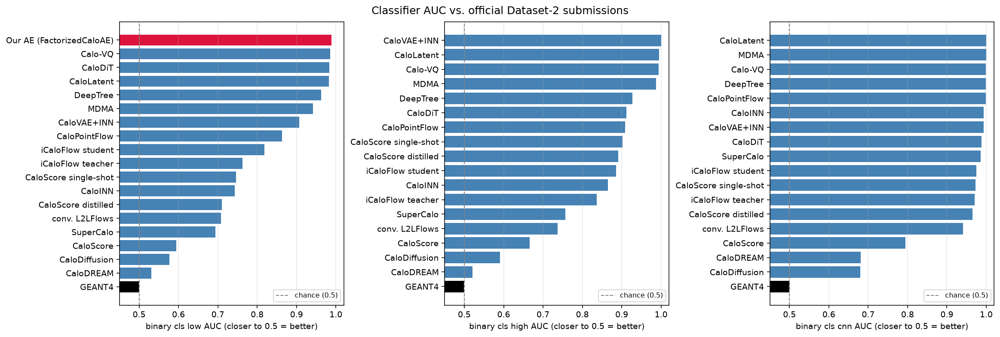
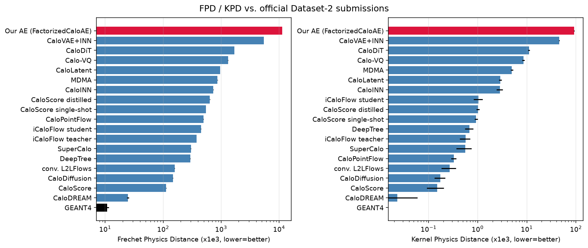
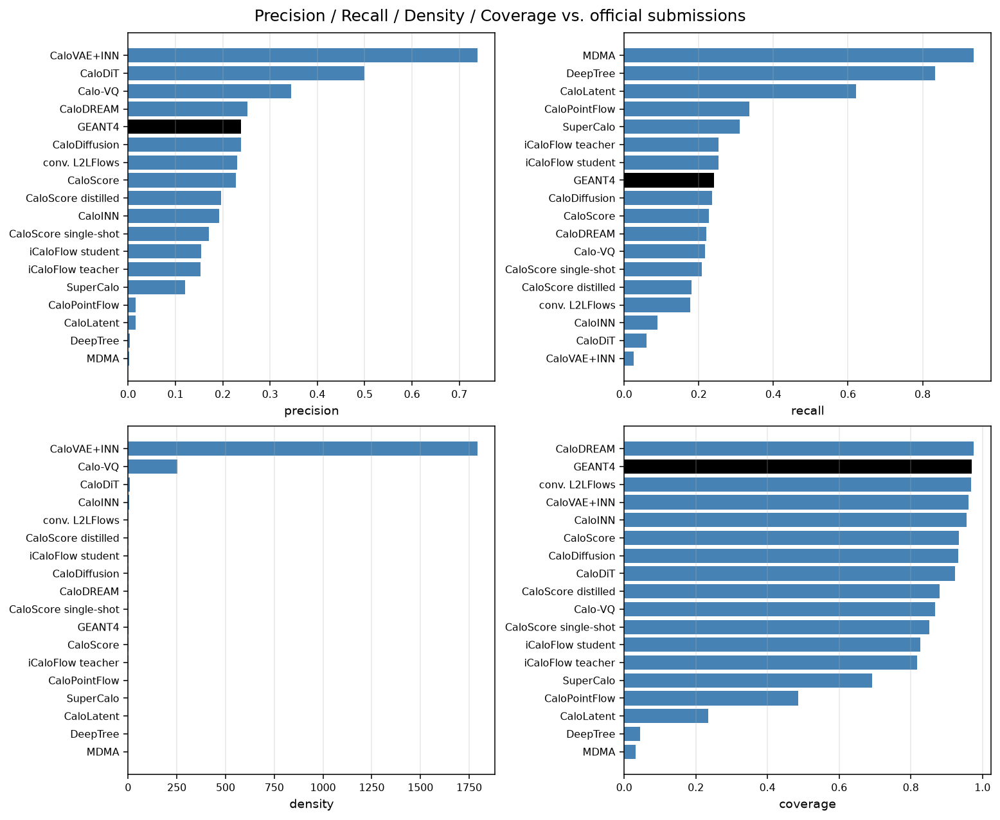
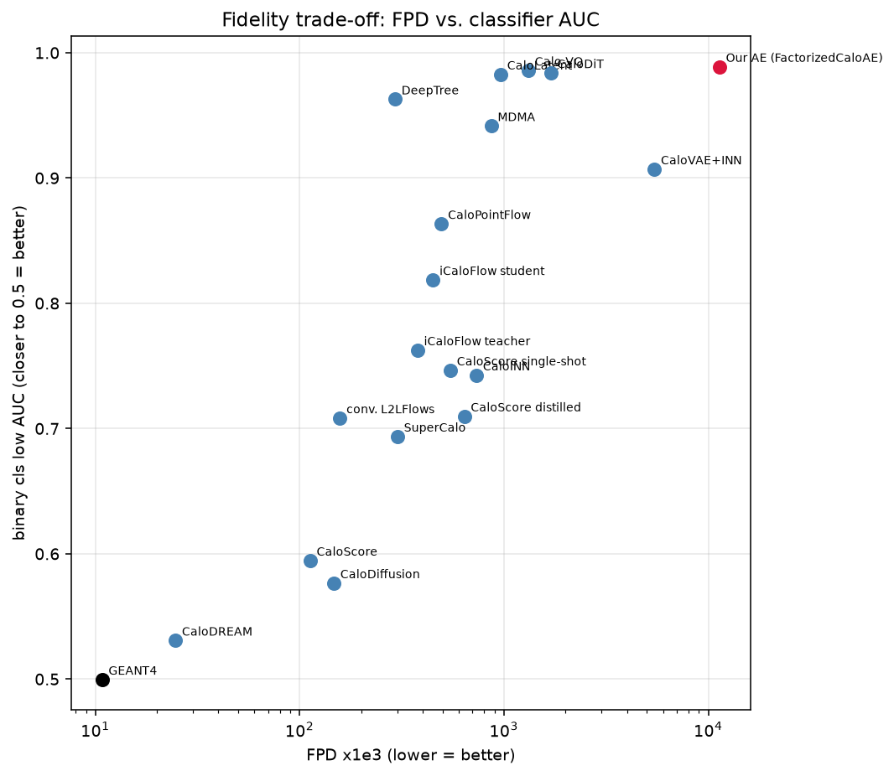

# PINNDE for Calorimeter Simulation : Generative Models for CaloChallenge Dataset 2 | GSoC 2026


## Project Description :

This project continues the PINNDE programme — building a fast sampler by solving the
reverse-time diffusion equation with physics-informed networks — and takes it from
toy distributions in 1, 2 and 3 dimensions to a real high-energy-physics benchmark:
**Dataset 2 of the [Fast Calorimeter Simulation Challenge 2022](https://calochallenge.github.io/homepage/)**.

Dataset 2 is a 45 layer × 16 φ × 9 r = **6,480-dimensional** electromagnetic shower
image, conditioned on incident energy across three decades, in which **75% of voxels
are exactly zero**. It is a hard target for the method for exactly the reasons that
make it interesting: the dimensionality, the sparsity, and the fact that total
deposited energy must track the incident energy over three orders of magnitude.

Four approaches were built and evaluated with the official challenge metrics. The best
of them — a **two-stage factorization** that generates energy ratios and per-layer
shapes separately — reaches a low-level classifier AUC of **0.578**, statistically
indistinguishable from CaloDiffusion (0.577), which placed second among the 17
published submissions.

### What was Accomplished?

As part of GSoC 2026 I contributed to this project with the organisation Machine
Learning for Science [ML4SCI](https://ml4sci.org/), under the mentorship of
Prof. Harrison Prosper, Prof. Pushpalatha Bhat, and Prof. Sergei Gleyzer. The project
is part of the broader [GENIE](https://ml4sci.org/activities/gsoc2025.html) initiative
within ML4SCI, which explores machine learning for event generation and anomaly
detection in high-energy particle physics.

- Scaled the PINNDE formulation from 3 dimensions to the **6,480-dimensional**
  Dataset-2 shower, and established where the original flow-map formulation breaks
  down (MSE scaling as roughly `N^-0.29` in the number of collocation points).
- Built and evaluated **four successive models**, each one motivated by a measured
  failure of the previous: a latent-diffusion model, a direct voxel-space PINN sampler
  in two architectures, and a two-stage factorized model.
- Reached a low-level classifier AUC of **0.578** with the two-stage model, on par with
  the second-placed published submission, and a mean histogram χ² of **0.0017**.
- Derived and implemented a factorization in which **energy conservation is exact by
  construction** — a stick-breaking parameterization of layer energy ratios, so the
  network never has to learn a conservation law it can only approximate.
- Showed that reconstruction error and classifier separability are **close to decoupled**:
  five times the autoencoder training gave the same reconstruction error and a *worse*
  classifier score. This is the central reason the latent-diffusion path was abandoned.
- Traced the autoencoder's ceiling to a **single feature** — the count of sub-MeV hits,
  which alone gives AUC 0.966 against the full model's 0.9888.
- Ran the full official evaluation suite (classifier AUC low/high/CNN, FPD, KPD, PRDC,
  227 histogram χ²) on every model and compared against all 17 published submissions.
- Reorganised the whole codebase into an installable library with per-model entrypoints,
  committed evaluation results, regenerable tables and a test suite.

Following are the relevant documents pertaining to this project.

- Code on GENIE Github Repository: (coming soon)
- Code on my Github Repository (my fork) : (coming soon)
- Project Documentation: [docs/MODEL_EVOLUTION.md](docs/MODEL_EVOLUTION.md) — start here
- Final blog : (coming soon !!)

#### Other Important Documents:

- Previous year's work this builds on : [PINNDE | GSoC 2025](https://github.com/ML4SCI/GENIE/tree/main/Physics_Informed_Neural_Network_Diffusion_Equation_Sijil_Jose)
- Mid-term blog from GSoC 2025 : [PINNDE mid-term blog](https://medium.com/@sijiljose.999/gsoc-2025-with-ml4sci-part-i-physics-informed-neural-network-for-diffusion-equation-pinnde-491d46a5b84d)
- The challenge : [Fast Calorimeter Simulation Challenge 2022](https://calochallenge.github.io/homepage/)
- Published results we compare against : [arXiv:2410.21611](https://arxiv.org/abs/2410.21611), Tables C15/C16
- CaloDREAM, the closest published method : [arXiv:2405.09629](https://arxiv.org/abs/2405.09629)
- Final Document / Preprint : (Coming Soon!!)

### Next Steps

- Close the high-level and convolutional classifier gap (0.695 / 0.804 against the
  two-stage model's 0.578 low-level). The defect is in voxel-to-voxel correlations,
  not in the marginals.
- Address exposure bias between the two stages: stage B is trained on true energy
  ratios but sampled on stage A's. The `teacher_forced.py` / `--ceiling` diagnostic
  separates the two contributions; the queued experiments are in
  [docs/EXPERIMENTS.md](docs/EXPERIMENTS.md).
- Handle the degenerate region of the factorization — 44.8% of showers have at least
  one undefined energy ratio and stage A currently has no mechanism for them.
- Wire a `--config` loader so the per-model `configs/*.yaml` are consumed rather than
  only recorded.
- Add unit tests for the sampler and the export path.

### My Contributions:

The entire codebase in this repository was written during the GSoC 2026 coding period,
building on the PINNDE formulation developed in GSoC 2025. The four models, the
preprocessing and representation code, the evaluation and comparison tooling, the
hyperparameter sweeps and the documentation are all original work for this project.

- Code on GENIE Github Repository: (coming soon)
- Code on my Github Repository (my fork) : (coming soon)

I have also worked on documenting the project, including a lab notebook that records
the failures alongside the successes:

- [docs/PINNDE_LAB_NOTEBOOK.md](docs/PINNDE_LAB_NOTEBOOK.md) — every experiment run
- [docs/MODEL_EVOLUTION.md](docs/MODEL_EVOLUTION.md) §9 — five conclusions that were
  stated confidently and later overturned by a control, kept deliberately
- Final blog / Preprint of the article: (Coming Soon !!)

## Results

Binary-classifier AUC against Geant4 — 0.5 is indistinguishable, 1.0 is trivially
separable.

| model | cls-low | cls-high | cls-resnet | mean χ² | params |
|---|---:|---:|---:|---:|---:|
| **two-stage factorization** | **0.578** | 0.695 | 0.804 | **0.0017** | 3.5 M |
| direct PINN sampler (conv U-Net) | 0.683 | 0.925 | 0.894 | 0.0082 | 2.5 M |
| latent diffusion | 0.991 | 1.000 | 1.000 | 0.151 | 1.0 M + 3.1 M |
| — autoencoder reconstruction (its ceiling) | 0.989 | — | — | 0.139 | 3.1 M |
| direct PINN sampler (flat MLP) | 0.999 | 1.000 | 1.000 | 0.182 | 22.8 M |

Against the 17 published submissions: CaloDREAM 0.531, **CaloDiffusion 0.577**,
CaloScore 0.595, median 0.755. The two-stage model's low-level AUC matches
CaloDiffusion, which placed second — though it falls to roughly 4th on the high-level
and convolutional classifiers. See [docs/MODEL_COMPARISON.md](docs/MODEL_COMPARISON.md)
for the honest reading.

Every number above is regenerated from committed files, never transcribed:

```bash
python results/make_tables.py
```

## Quickstart

```bash
pip install -e .                       # or: export PYTHONPATH=src
pytest                                 # seconds, no GPU or data file needed
```

Get Dataset 2 from the challenge's Zenodo record — `dataset_2_1.hdf5` to train on,
`dataset_2_2.hdf5` as the evaluation reference, **never the other way round** — and
convert:

```python
import h5py, torch
with h5py.File('dataset_2_1.hdf5') as f:
    sh = torch.tensor(f['showers'][:], dtype=torch.float32)
    en = torch.tensor(f['incident_energies'][:], dtype=torch.float32)
torch.save({'showers': sh.reshape(-1, 45, 16, 9),
            'energies': en.reshape(-1, 1)}, 'data/Dataset2.pt')
```

Both arrays stay in **MeV**. Converting only one cost this project a long training
plateau — see [docs/REPLICATION.md](docs/REPLICATION.md) §15.1.

Then train the best model:

```bash
python models/3_two_stage/train.py --data data/Dataset2.pt \
    --checkpoint-energy checkpoints/ts_energy.pt \
    --checkpoint-shape  checkpoints/ts_shape.pt \
    --steps-energy 20000 --steps-shape 100000 --cond conv --batch 64 \
    --export generated/two_stage_ds2_100k.hdf5 --n-sample 100000 --sample-steps 50
```

### Description of Directories and files:

```
src/calods2/            the library — shared by every model, loads nothing on import
├── data/               dataset.py  calo_dataset.py  layerdata.py  export.py
├── models/             velocity_net.py  flow_de.py  autoencoder.py  ae_losses.py
├── metrics/            quick_metrics.py  sweep.py
└── training/           ae_trainer.py

models/                 one directory per approach, each with its own README
├── 0_original_flowmap/   the formulation that failed, kept for the record
├── 1_latent_diffusion/   at its reconstruction ceiling
├── 2_direct_pinn/        6480-voxel reverse-time ODE
└── 3_two_stage/          energy ratios + per-layer shape        <- best model

scripts/                tooling: figures, diagnostics, visualization, cluster jobs
sweeps/                 SLURM array jobs for the latent-dimension sweep
results/                committed evaluation text + make_tables.py
docs/                   the documentation set + figures/ + archive/
notebooks/              exploratory plots of the raw dataset
tests/                  pytest, no data file required
CaloChallenge/          only the upstream clone (gitignored)
```

The three generative models share one ```VelocityNet``` and one Heun sampler. What
differs between them is the **choice of coordinates**, not the machinery — which is why
the library is factored this way, and why each model directory holds only a thin
entrypoint.

- ```src/calods2``` : the installable library. Nothing here loads data at import time.
  - ```data/dataset.py``` : the fraction/threshold representation used by the direct
    PINN path, and the toy-distribution samplers carried over from GSoC 2025.
  - ```data/calo_dataset.py``` : Dataset-2 loading, the log transform, the standardization
    constants and the train/validation split.
  - ```data/layerdata.py``` : the two-stage representation — stick-breaking energy ratios
    `u` and per-layer normalized shapes `w`, with the inverse transform.
  - ```data/export.py``` : conversion back to physical units and the CaloChallenge-format
    HDF5 writer.
  - ```models/velocity_net.py``` : ```VelocityNet```, the single network shared by all three
    generative models, plus ```from_checkpoint()```.
  - ```models/flow_de.py``` : the Monte-Carlo q-field reference implementation, the direct
    descendant of GSoC 2025's ```flow_de.py```.
  - ```models/autoencoder.py``` : ```FactorizedCaloAE```, the conditional autoencoder.
  - ```models/ae_losses.py``` : the v3 / v4 / v5 objectives, the focal-loss hurdle model
    and the threshold tuner.
  - ```metrics/quick_metrics.py```, ```metrics/sweep.py``` : fast offline diagnostics that
    do not require the full official evaluation.
  - ```training/ae_trainer.py``` : the autoencoder training loop.

- ```models``` : one directory per approach, each with its own README stating what it
  scored and why it was superseded, and a ```configs/``` recording the hyperparameters
  each reported run was trained with.
  - ```0_original_flowmap/``` : the formulation inherited from GSoC 2025, kept for the
    record along with the measurements that ruled it out at 6,480 dimensions.
    ```train_calo_pinnde.py```, ```networks_calo.py```, ```sample_and_export.py```,
    ```generate_anchor_trajectories.py```.
  - ```1_latent_diffusion/``` : train the autoencoder, then diffuse in its latent space.
    Stopped at its reconstruction ceiling. ```train_autoencoder.py``` then
    ```train_latent.py```, with ```generate_caloeval_hdf5.py``` to write a reconstruction
    in CaloChallenge HDF5 format.
  - ```2_direct_pinn/``` : the reverse-time ODE solved directly in all 6,480 voxels, in a
    flat-MLP and a convolutional U-Net variant. ```train.py```, ```sample.py```.
  - ```3_two_stage/``` : energy ratios and per-layer shape generated separately.
    **Best model.** ```train.py``` trains both stages and can export in one invocation;
    ```teacher_forced.py``` is the ```--ceiling``` diagnostic that separates stage A's
    error from stage B's by sampling stage B on *true* energy ratios.

- ```scripts``` : tooling that is not part of the library and not a model entrypoint.
  - ```build_comparison_plots.py``` : reads the official results table and this project's
    evaluation output and writes every figure in ```docs/figures/```. The comparison
    numbers are parsed live, never hand-copied from the paper.
  - ```compare_to_reference.py``` : checks a generated file against the evaluation's own
    reference — units, thresholds, empty-voxel structure. The script that ruled out a
    units artifact as the cause of AUC ≈ 1.
  - ```viz/``` : ```visualize_calo_ae.py``` (reconstruction-quality plots),
    ```visualize_correlations.py```, ```visualize_latent_structure.py``` (PCA / t-SNE /
    energy-bin separation of the latent space).
  - ```diagnostics/``` : ```ae_baselines.py``` (the autoencoder against zeros, the mean
    shower and PCA-k, with a verdict), ```ae_sweep.py```, ```diagnose_training_plateau.py```,
    ```quick_residual_check.py```, ```subsample_hdf5.py```.
  - ```cluster/``` : ```run_full_evaluation.py```, the driver that regenerates a
    reconstruction, runs all three classifier modes plus FPD/KPD/PRDC and rebuilds the
    comparison plots, along with its SLURM wrappers and a self-healing training watchdog.

- ```sweeps``` : the SLURM array-job orchestration for the latent-dimension sweep and its
  harvested results. **Read its README before using any number from it** — the sweep ran
  on three diverged copies of the training script and is not a controlled comparison.
- ```results``` : the committed text output of every official evaluation, one directory
  per run with a ```config.yaml``` beside it, plus ```make_tables.py``` which regenerates
  every table in every document from those files.
- ```docs``` : the documentation set, listed below, plus ```figures/```, the methods PDF
  and ```archive/```, which keeps superseded documents with their paths marked stale.
- ```notebooks``` : ```PlotDataset2.ipynb```, exploratory plots of the raw dataset.
- ```tests``` : pytest suite. Runs in seconds and needs no data file.
- ```CaloChallenge``` : **nothing but a clone of the official challenge repository**,
  gitignored because it carries its own ```.git```. Clone it as a setup step; see that
  directory's README.
- ```README.md``` : this documentation file.

### Documentation

| doc | what it is |
|---|---|
| [MODEL_EVOLUTION.md](docs/MODEL_EVOLUTION.md) | **start here.** Why each model was built, what test exposed its limit, and a point-by-point comparison with CaloDREAM |
| [REPLICATION.md](docs/REPLICATION.md) | end-to-end specification: preprocessing, architectures, losses, schedules, eight pitfalls |
| [MODEL_COMPARISON.md](docs/MODEL_COMPARISON.md) | results, and the comparison with all 17 published submissions |
| [EXPERIMENTS.md](docs/EXPERIMENTS.md) | the open experiments, each with a control and a falsification criterion |
| [NOVA_TRANSFER.md](docs/NOVA_TRANSFER.md) | sparse-autoencoder techniques adapted from a NOvA CAE report, and what they exposed |
| [PINNDE_LAB_NOTEBOOK.md](docs/PINNDE_LAB_NOTEBOOK.md) | the running lab notebook: every experiment, including the failures |

# Overview of interesting results obtained during this program (Plots):

### Classifier AUC against the published submissions:



The three classifier metrics for each model in this project placed against all 17
published Dataset-2 submissions. The low-level classifier sees raw voxels, the
high-level classifier sees derived per-layer features, and cls-resnet is a
convolutional network on the shower image. The two-stage model's low-level score sits
with the leaders; its high-level and convolutional scores do not, which localises the
remaining defect to voxel-to-voxel correlations rather than to the marginal
distributions.

### Fréchet and kernel physics distances:



FPD and KPD measure the distance between the generated and reference distributions in
a fixed feature space, with a Geant4-against-itself row giving the floor. These are the
metrics on which the two-stage model's improvement over the direct PINN sampler is
largest.

### Precision, recall, density and coverage:



PRDC separates sample *quality* (precision, density) from sample *diversity* (recall,
coverage). A model can score well on a classifier while quietly covering only part of
the distribution, and this is where that would show.

### The quality–cost trade-off:



Classifier AUC against FPD for every submission. Points toward the lower left are
better on both axes at once. The interest of the two-stage model is not that it wins —
it does not — but that it reaches the leading group's low-level score with 3.5 M
parameters and a 50-step sampler.
